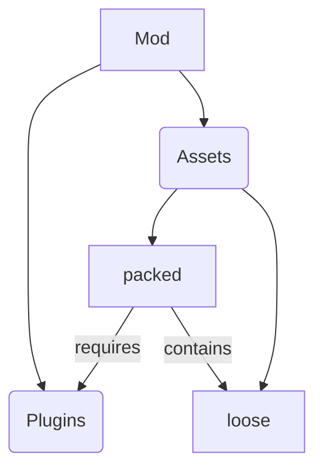

!!! abstract "Summary"
    This page covers the folders relevant to Skyrim modding as well as related terminology. I will explain the differences between the root and data folder, and how this affects mods. Finally, we will look at mod file types and why mod managers are important.

## Vanilla Folders

To follow along with this article, it's helpful to have a clean copy of the vanilla game on hand (refer [these instructions](/companion/foundation/step-1/#uninstalling-skyrim) to perform a clean install of the game). We will take a look at each relevant folder and the files they contain.

### INI / Documents Folder

First, let's look at the **INI Folder**, so called because it contains the main INI files.[^1] Sometimes, this folder is also referred to as the **Documents Folder** because it is located in the `\Documents\` folder.

[^1]:   INI files are plain-text configuration files for applications. They usually have the file extension `.ini` which stands for *initialisation*. Check out [the Wikipedia article](https://en.wikipedia.org/wiki/INI_file) for more information.

- Navigate to `C:\Users\<Your User Name>\Documents\My Games\Skyrim Special Edition\`.

This directory contains multiple files and folders:

- The **Skyrim.ini** and **SkyrimPrefs.ini** are the game's primary configuration (INI) files.
- There may also be a **saves** folder which, you guessed it, contains your save games.
    - *If you have no saves in Steam's cloud save, there will probably be no **saves** folder yet since we just performed a clean install.*

The **INI folder** is also used by some mods and tools, usually to store logs. That's why this folder is also wiped as part of a clean install.

## Root Folder

Next, let's take a look at the game files.

- Navigate to your Skyrim installation: `\Steam\steamapps\common\Skyrim Special Edition\`.

!!! Tip
    Right-click the game in your Steam library and select Manage ➜ Browse local files.

This is the **root folder** (also called **game folder** by some).

The root folder contains the two executables: **SkyrimSE.exe**, which directly opens the game, and **SkyrimSELauncher.exe**, which starts the launcher first. The latter is what Steam runs when you start the game from your inside the Steam interface.

## Data Folder

The **data folder** is located within the **root folder**: `\Skyrim Special Edition\Data\`.

- Open the **data folder**.

The **data folder** contains all game files which are split into **plugins (ESMs)** and **archives (BSAs)**: There are five ESMs containing all records and 18 BSAs containing all assets. The five ESMs are also known as the **official master files**.

What precisely plugins and archives are and what they do will be discussed later on. For now, it is enough to know that they contain the bulk of the game data.

Any files beginning with **cc** are from the Creation Club. The creations are also organised in archives with associated plugins (though their file extensions vary – a topic for later).

### Data Folder Files

Mods have the same basic structure as the official game files.

There are **plugins** and **assets**:

- **Plugins** contain game data. They have the file extension **ESP**, **ESL**, or **ESM**.
- **Assets** are loose files. There are many types, including textures, meshes, scripts, and so on – each with their own file extension.

**Assets** are often stored in **archives (BSAs)**. You can think of BSAs as ZIP archives for Skyrim assets. Archives require a plugin of the same name to be loaded: For example, `My Tree Overhaul.bsa` is loaded by `My Tree Overhaul.esp`.

==Like the base game files, mods almost always belong in the **data folder**.==[^2] If you install a mod into the root folder, it will simply not be recognised by the game and will not work.

[^2]: There are some notable exceptions to this rule (SKSE, the SKSE Preloader, ReShade, and ENB). Generally speaking, you know that a mod belongs into the data folder if it contains plugins or its folder structure replicates that of the base game. This is the case for the vast majority of mods.

## Mod Managers

Imagine this: You install 100 mods. Each of these mods consists of a different combination of plugins, archives, and loose files. You extract all of these files into the data folder. Many of them interact: they contain some of the same files (as in: files with the same name), either because they randomly overlap or because they intentionally modify each other. As you install these mods, they overwrite each other in the order of installation.

Now you want to update or remove a mod. Oh, no.

Unless you remember *exactly* which files belong to that mod ^^and^^ they never interacted with files from other mods, you now have a veritable situation on your hands. Fun issues that may ensue include "purple" objects as a result of mismatched meshes and textures, or broken quests due to overwritten or missing scripts. It is virtually impossible to build a functioning setup of even moderate dimensions in this fashion.

==That is why we use mod managers to manage data folder files.==

---

:arrow_right: **[Return to the Companion](/companion/foundation/step-2)**