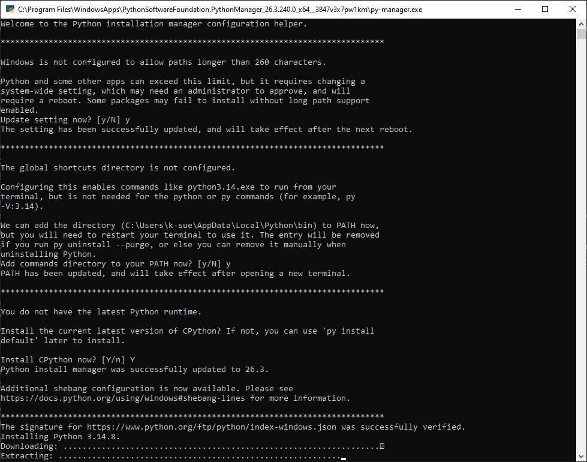

# Zensical

My website is powered by [Zensical](https://zensical.org/), a static site generator. Zensical was created by the team behind [Material for MkDocs](https://squidfunk.github.io/mkdocs-material/) and is geared toward documentation sites. Currently, Zensical is in alpha.

This page explains how to set up Zensical and this website on a new machine.

## How to set up the site

The [Zensical documentation](https://zensical.org/docs/get-started/) also details the setup process. However, you can find all relevant information for a setup on Windows here.

### Installing Python

You can skip this step if you have already installed Python on your PC.

- Download the latest version of [Python for Windows](https://www.python.org/downloads/) from the official website.
- Run the downloaded file to install Python.

The terminal will open. 

- If prompted: Enable long path support. 
- If prompted: Do not add Python to PATH.
    -  *I initially did add Python but this should not be necessary because we run Python from a virtual environment.*
- Finally, confirm to install the latest version of Python.
- Restart your PC.



### Cloning the repository

- Install [Git](https://git-scm.com/install/windows) if you haven't done so already.
- Open the Command Prompt and run the following commands one by one:

```  { .yaml .annotate }
cd /d C:\ #(1)!
mkdir Drive:\My\Project\Folder
cd /d C:\Zensical
git clone https://github.com/The-Modders-Companion/docs.git .
```

1. Use this command to switch to the top level of the drive on which you would like to set up the project folder. The argument `/d` is necessary to switch between drives. `C:\` can be any drive letter.

### Installing Zensical

Finally, install Zensical into the new project folder:

- Run the following commands one by one in the Command Prompt while in the project folder directory:

```
python -m venv .venv
.venv\Scripts\activate
pip install zensical 
```

### Running Zensical 

### Setting up a .gitignore

- In the project folder, create a `.gitignore` file.
    -  *Make sure this file does not have a TXT file extension.*
- Open your `.gitignore` in Notepad or similar and paste the following:

```yaml
.venv/
/site/ #(1)!
```

1. Starting with a backslash is necessary to specify the top-level `site` folder and avoid excluding any other folders with the same name.

- Save and close the file.

## Updating Zensical

Instructions on how to update Zensical can be found on the [official website](https://zensical.org/docs/upgrade/) and the changelog is [here](https://github.com/zensical/zensical/releases).

To check the currently installed version, run:

```
pip show zensical
```

To update Zensical, run:

```
pip install --upgrade --force-reinstall zensical
```


## Plugins

I am using a few plugins for Zensical. The following documents their installation.

### Awesome Nav

See [Awesome Nav](https://zensical.org/docs/compatibility/mkdocs/plugins/#awesome-nav) in the official Zensical documentation or refer to the [original plugin's documentation](https://lukasgeiter.github.io/mkdocs-awesome-nav/).

- Enable the plugin by adding `[project.plugins.awesome-nav]` to the `zensical.toml`.
- Create a `.nav.yml` file inside `\docs\`.

This file determines the order of tabs if that feature -- `  "navigation.tabs",` -- is enabled in the `zensical.toml`.

```yaml
site:
    resources
    blog
```
Then create folders and sub-folders for each section and page:

```
docs/
├─ .nav.yml
└─ resources/
   └─ site/
        └─zensical.md
└─ blog/
   └─ index.md
```